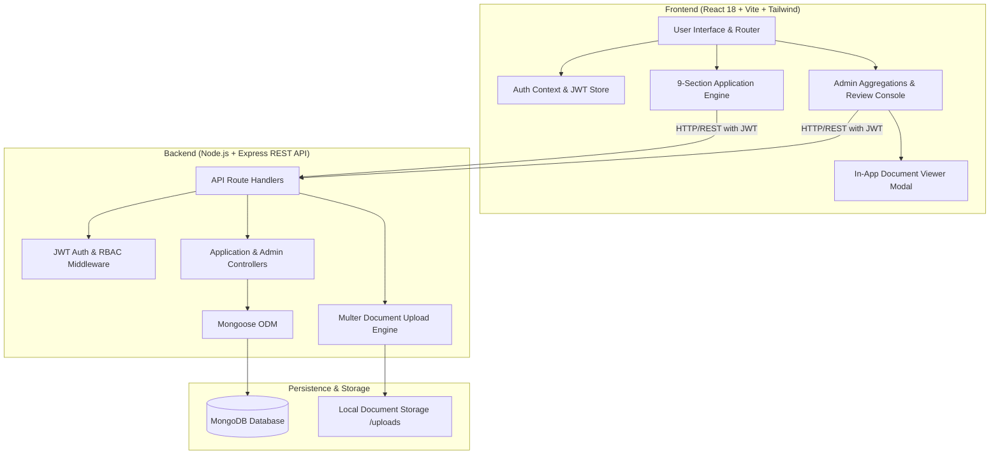
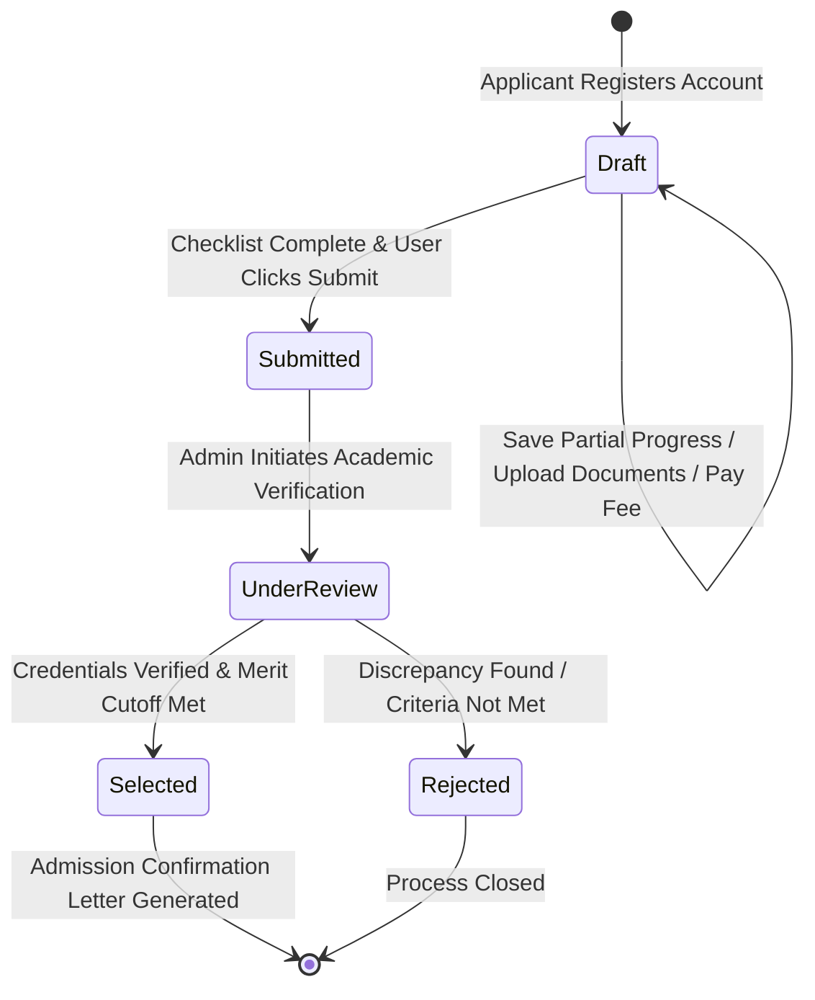

# College Admission Management & Verification Portal (MERN Stack)
### Software Engineering (SWE) Academic Project & Admissions System

A full-stack, enterprise-grade College Admission and Document Verification System inspired by the Institute of Engineering & Management (IEM) admission workflow. Built with the **MERN Stack (MongoDB, Express.js, React, Node.js)** and styled with **Tailwind CSS**.

---

## 📌 Executive Summary & System Highlights
- **Role-Based Access Control (RBAC):** Distinct workflows and dashboards for **Applicants** and **Administrative Staff**.
- **Dynamic 9-Section Form Engine:** Covers Personal Information, Class 10 & 12 education, auto-calculated percentages, PCM score breakups, entrance exam metrics (JEE Main percentile, WBJEE rank, IEMJEE score), and branch preferences.
- **Cross-Field Validation & Auto-Calculations:** Dynamic passing year checks (`Class 12 Year > Class 10 Year`), real-time percentage calculations, and conditional examination fields.
- **In-App PDF & Document Viewer Modal:** Built-in modal viewer allowing administrators to preview, zoom, and inspect marksheets, rank cards, and government ID proofs without downloading external files.
- **Dynamic Missing Requirements Checklist:** Real-time checklist that evaluates application completeness and blocks submission until all criteria, documents, and fee payments are verified.
- **Application Locking:** Submitting freezes applicant input and transitions the record into a read-only state during administrative review.
- **Administrative Decision & Audit Trail:** Interactive staff remarks, verification switches, state transitions (`Draft` &rarr; `Submitted` &rarr; `Under Review` &rarr; `Selected` / `Rejected`), and timestamped event history.

---

## 🏗️ System Architecture



---

## 🔄 Application State Machine Workflow



---

## 📂 Repository File Structure

```
college-admission-portal/
├── client/                             # React 18 + Vite Frontend
│   ├── public/                         # Static icons & public assets
│   ├── src/
│   │   ├── components/
│   │   │   ├── Navbar.jsx              # Navigation header with IEM/UEM branding
│   │   │   └── DocumentModal.jsx       # In-App PDF & Document viewer modal
│   │   ├── context/
│   │   │   └── AuthContext.jsx         # Global user state & JWT handling
│   │   ├── pages/
│   │   │   ├── Login.jsx               # Auth login with 1-click test credentials
│   │   │   ├── Register.jsx            # Applicant registration form
│   │   │   ├── ApplicantDashboard.jsx  # Multi-card application form & checklist
│   │   │   ├── AdminDashboard.jsx      # Aggregations, search filters & table
│   │   │   └── AdminApplicationDetail.jsx # Deep-dive review & decision console
│   │   ├── services/
│   │   │   └── api.js                  # Axios client with bearer token interceptor
│   │   ├── App.jsx                     # Route declarations & role guards
│   │   ├── index.css                   # Custom styles matching IEM portal
│   │   └── main.jsx                    # Application entry point
│   ├── index.html                      # HTML5 root template
│   ├── package.json                    # Client dependencies
│   ├── tailwind.config.js              # Theme colors (#0b4a8f, #083563, etc.)
│   └── vite.config.js                  # Proxy configuration to API
│
├── server/                             # Node.js + Express Backend
│   ├── src/
│   │   ├── controllers/
│   │   │   ├── adminController.js      # Aggregation metrics, search, verification
│   │   │   ├── applicationController.js# Draft saving, checklist, submission, fee
│   │   │   ├── authController.js       # Register, login, JWT issuance
│   │   │   └── courseController.js     # Programs, boards, states & options
│   │   ├── middleware/
│   │   │   ├── auth.js                 # JWT verification & role authorization
│   │   │   └── upload.js               # Multer file validation (PDF, JPG, PNG)
│   │   ├── models/
│   │   │   ├── Application.js          # Master candidate dossier schema
│   │   │   ├── Course.js               # Academic course schema
│   │   │   └── User.js                 # User credentials & RBAC schema
│   │   ├── routes/
│   │   │   ├── adminRoutes.js          # /api/admin/*
│   │   │   ├── applicationRoutes.js    # /api/applications/*
│   │   │   ├── authRoutes.js           # /api/auth/*
│   │   │   └── courseRoutes.js         # /api/*
│   │   ├── seed.js                     # Pre-seeded admin and sample applicants
│   │   └── server.js                   # Express server bootloader
│   ├── uploads/                        # Uploaded applicant documents
│   ├── .env.example                    # Sample environment variables
│   └── package.json                    # Server dependencies
│
├── package.json                        # Monorepo root runner scripts
└── README.md                           # Project report & documentation
```

---

## 🚀 Setup & Execution Guide

### Prerequisites
1. **Node.js (v18 or v20 LTS):** [Download Node.js](https://nodejs.org/)
2. **MongoDB Database:**
   - **Local MongoDB Community Server:** [Download MongoDB](https://www.mongodb.com/try/download/community) (runs on `mongodb://localhost:27017`), **OR**
   - **Free MongoDB Atlas Cloud Cluster:** Create a free connection string at [MongoDB Atlas](https://www.mongodb.com/atlas).

---

### Step 1: Install Dependencies
Open a terminal in the project directory:

```bash
# Install backend dependencies
cd server
npm install

# Install frontend dependencies
cd ../client
npm install
```

---

### Step 2: Configure Environment Variables
Inside `server/`, create a `.env` file (copied from `.env.example`):

```env
PORT=5000
MONGODB_URI=mongodb://127.0.0.1:27017/college_admission_db
JWT_SECRET=super_secret_jwt_token_for_college_swe_project_2026
JWT_EXPIRES_IN=7d
CLIENT_URL=http://localhost:5173
```
*(If using MongoDB Atlas, replace `MONGODB_URI` with your cloud URI).*

---

### Step 3: Seed Database with Initial Demo Accounts
Run the seed script from `server/` to populate admin credentials, academic programs, and test applications in various statuses:

```bash
cd server
npm run seed
```

---

### Step 4: Run the Application
Open two terminal windows:

**Terminal 1 (Backend Server):**
```bash
cd server
npm start
```
*Backend will run on: `http://localhost:5000`*

**Terminal 2 (Frontend Client):**
```bash
cd client
npm run dev
```
*Frontend will run on: `http://localhost:5173`*

---

## 🔑 Pre-Seeded Test Credentials

| Role | Email | Password | Pre-loaded Data / Status |
|---|---|---|---|
| **Admin Officer** | `admin@iem.edu` | `Admin@123` | Full administrative review & verification access |
| **Applicant 1** | `rohan.sharma@example.com` | `User@123` | **Submitted** application (ready for admin review) |
| **Applicant 2** | `ananya.sen@example.com` | `User@123` | **Under Review** (academic verification in progress) |
| **Applicant 3** | `priyanka.m@example.com` | `User@123` | **Selected** (CSE branch allotment confirmed) |

> 💡 *Tip: The Login page also includes **1-Click Quick Fill buttons** so you or your examiners can test without typing credentials!*

---

## 📡 REST API Reference

| Method | Endpoint | Access | Description |
|---|---|---|---|
| `POST` | `/api/auth/register` | Public | Register new applicant account and initialize draft |
| `POST` | `/api/auth/login` | Public | Authenticate user and receive JWT bearer token |
| `GET` | `/api/auth/me` | Private | Get profile details of current session |
| `GET` | `/api/courses` | Public | List available engineering degree programs |
| `GET` | `/api/document-types` | Public | List document upload requirements and formats |
| `GET` | `/api/form-options` | Public | Dropdown options for states, boards, categories, exams |
| `GET` | `/api/applications/my` | Applicant | Retrieve current student application & missing checklist |
| `POST` | `/api/applications/draft` | Applicant | Save form changes without locking application |
| `POST` | `/api/fee/pay` | Applicant | Record bank/UPI transaction reference number |
| `POST` | `/api/documents/upload` | Applicant | Upload marksheets / rank card (PDF, JPG, PNG) |
| `POST` | `/api/applications/submit`| Applicant | Final submission & form lock |
| `GET` | `/api/admin/dashboard` | Admin | Aggregate metrics (totals, status counts, fees) |
| `GET` | `/api/admin/applications`| Admin | Filterable, searchable, paginated applications table |
| `GET` | `/api/admin/applications/:id`| Admin | Complete candidate file with documents & audit history |
| `POST`| `/api/admin/applications/:id/verify`| Admin | Record staff verification marks and remarks |
| `POST`| `/api/admin/applications/:id/status`| Admin | Transition application status (`Under Review`, `Selected`, `Rejected`) |

---

## 🎓 Software Engineering (SWE) Academic Deliverables

### Functional Requirements (FRs)
- **FR1 (Authentication):** Users must register and log in with email and password, authenticated using salted bcrypt hashing and signed JWT tokens.
- **FR2 (Dossier Management):** Applicants must be able to input, edit, auto-calculate, and save drafts across 9 academic sections.
- **FR3 (Integrity Checklist):** The system must compute dynamic missing item checklists and prevent final submission until all academic fields, documents, and fee records are provided.
- **FR4 (In-App Document Inspection):** Staff members must be able to review uploaded marks cards directly within the application viewport.
- **FR5 (Audit Trail):** Every status transition must record the initiating actor, timestamp, and optional explanatory note in an immutable timeline.

### Non-Functional Requirements (NFRs)
- **Security:** Passwords salted with bcrypt (cost factor 10), routes protected by JWT bearer authentication, and file uploads validated for MIME-type and size.
- **Usability:** Responsive layout built with Tailwind CSS following IEM's institutional color palette (`#0b4a8f`, `#083563`, `#f4f7fb`).
- **Reliability:** Modular MVC design on Express and decoupled React frontend architecture.
